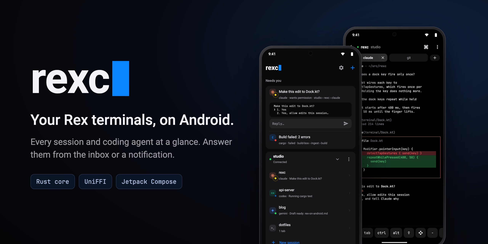
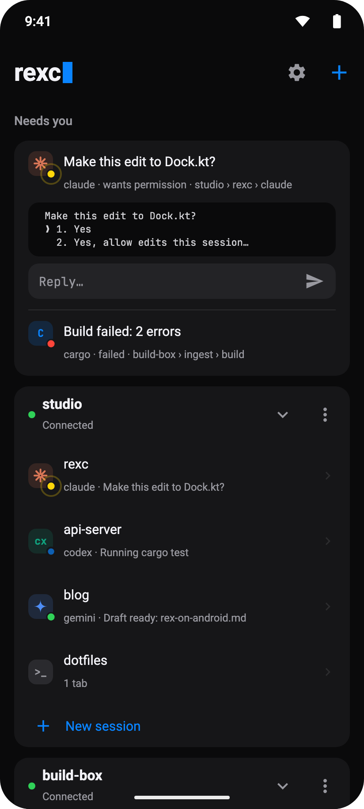
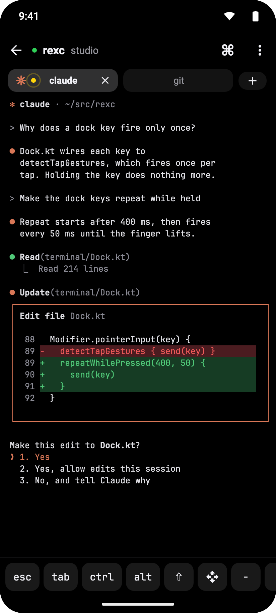
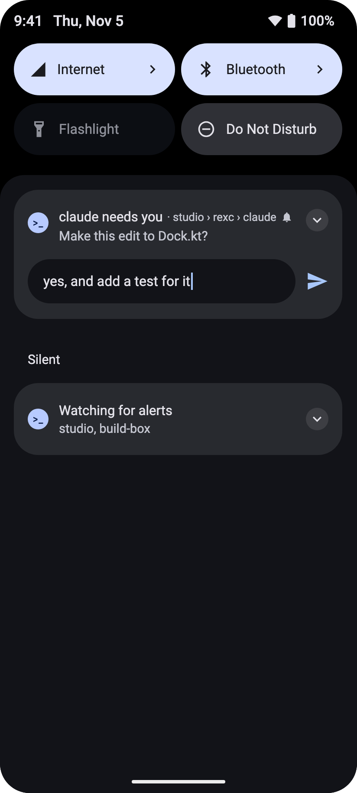
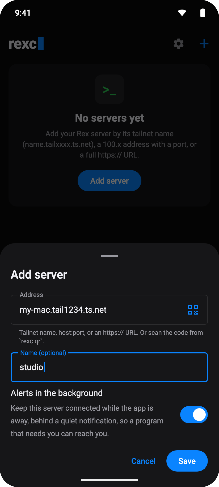

<p align="center">
  
</p>

# rexc

An Android client for the [Rex](https://rex.app) terminal multiplexer: your desktop sessions, tabs and panes on the phone, with alerts when a program (Claude Code, Codex, a build) needs you.

<p align="center">
  <a href="docs/media/rexc-intro.mp4"></a>
  <br>
  <sub>A 36-second tour. Click it for the full-quality MP4.</sub>
</p>

## What it does

- **An inbox for what needs you.** A blocked agent or a failed build rises to the top of Home with the pane's last lines and a reply field, so you answer without opening the terminal.
- **Every session, every agent.** Each server lists its sessions with the coding agent running in them (Claude Code, Codex, Gemini, Copilot) and a live dot: blue while it works, amber when it waits for you, green when it's done, red when it fails.
- **Alerts in the background.** A foreground service keeps watching your servers. Approve, decline or type a reply straight from the notification.
- **A real terminal.** libghostty-vt restores the desktop's exact screen and scrollback. Tabs follow the desktop's windows, and a key dock gives you esc, tab, ctrl, alt and arrows. The command palette and find bar are a tap away, and Settings picks the font, size and local echo.
- **Mirror or take over.** Watch a pane at the desktop's size while another client owns it, or take it over and it reflows to fit the phone.
- **Add a server with one scan.** `rexc qr` prints a code on the desktop, and the app's scanner fills in the address. Tailnet names work, with a MagicDNS fallback when the phone's DNS doesn't resolve them.

## Screenshots

| Home | Terminal | Alert | Add server |
|:-:|:-:|:-:|:-:|
|  |  |  |  |
| Agents that need you, then every session | The desktop pane, with a dock for keys phones lack | Answer from the notification shade | Type an address or scan the desktop's code |

## How it's built

```text
╭──────────────────────── android/ (Kotlin) ────────────────────────╮
│ Jetpack Compose · Hilt · Navigation 3 · MVI                       │
│ Canvas grid renderer · key dock · inbox · alert service           │
╰─────────────────────────────────┬─────────────────────────────────╯
                                  │ UniFFI: librexc_ffi.so + bindings
╭─────────────────────────────────┴───────── crates/ (Rust) ────────╮
│ rexc-ffi     Kotlin-friendly records, per-row dirty frames        │
│ rexc-core    engine: hosts, reconnects, ownership, input, alerts  │
│ rexc-term    terminal state on libghostty-vt                      │
│ rexc-client  tokio + rustls: WebSocket control, data streams      │
│ rexc-proto   the Rex wire protocol, plain data, no I/O            │
╰───────────────────────────────────────────────────────────────────╯
```

Everything that isn't drawing lives in Rust. The Kotlin side calls plain engine methods, gets coarse events back, and pulls the frame it needs to draw.

`crates/rexc-cli` pokes a server with the same crates: `ls`, `watch`, `screen`, `preview`, `reply` and `qr`.

## Build

Rust for Android needs zig (libghostty) and the NDK: `scripts/build-android.sh` produces `librexc_ffi.so` and the Kotlin bindings, then `cd android && ./gradlew assembleDebug`. `scripts/m4.sh` runs the same on a remote build machine.

Quality gates: `cargo test --workspace`, `./gradlew spotlessCheck detekt testDebugUnitTest`.

## Adding a server from the desktop

On the machine that runs Rex, print a code with the address the phone should use (tailnet name or `host:port`), then tap the scan icon in the app's "Add server" sheet:

```sh
rexc qr my-mac.tail1234.ts.net "my mac"
```

Any QR code whose text is just an address works too.

## Screenshots and video

The images and the intro video are drawn, not captured. [`docs/promo`](docs/promo) recreates the app's screens in React from the Compose theme's colors and spacing, and [Remotion](https://www.remotion.dev) renders them. See its README to change a screen and render again.
